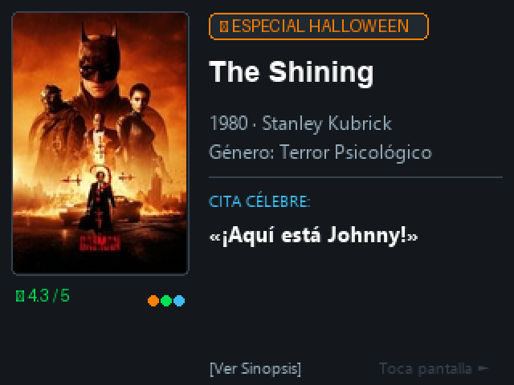

# 🎬 CYD Cinema — Recomendador de Cine Estilo Letterboxd
## ESP32-2432S028 (CYD 2.8" ST7789 320×240 + Touch XPT2046)

Dispositivo de sobremesa autónomo que muestra recomendaciones de películas, pósters oficiales de alta calidad, fichas técnicas y citas célebres con la estética oscura y minimalista de **Letterboxd**.



---

## ✨ Características principales

1. **Calendario Dinámico los 365 Días del Año**:
   - 📅 **Película del Día**: Cada día a medianoche se calcula matemáticamente una película destacada del día con insignia dedicada y la fecha en pantalla (ej: `31 OCT`, `01 NOV`).
   - 🎃 **Especial Halloween / Terror** *(15 Oct – 4 Nov)*: *The Shining, Halloween, Scream, Psycho, Alien, The Thing, The Silence of the Lambs, Hereditary...*
   - 🎄 **Especial Navidad / Invierno** *(1 Dic – 6 Ene)*: *Die Hard, Home Alone, The Nightmare Before Christmas, It's a Wonderful Life...*
   - 🏆 **Temporada de Premios Oscar** *(15 Ene – 15 Mar)*: *Parasite, The Godfather, Whiplash, The Silence of the Lambs...*
   - ⭐ **Grandes Hitos y Top Letterboxd** *(Resto del año)*: *Pulp Fiction, The Matrix, Interstellar, Blade Runner 2049, Fight Club...*
2. **Curiosidades y Anécdotas de Rodaje**:
   - Cada película incluye datos reales de producción, secretos de set y anécdotas de rodaje (por ejemplo, las hachas reales de Kubrick en *The Shining*, la máscara del Capitán Kirk de 2$ en *Halloween*, las llamadas reales del doblador en *Scream* o el chocolate usado en la ducha de *Psycho*).
3. **Soporte Bilingüe Español / Inglés (`ES` / `EN`)**:
   - Selector táctil directo en la cabecera `[ES | EN]` y mediante la web Wi-Fi.
   - Guardado permanente en memoria interna NVRAM.
   - En inglés muestra las citas originales de Hollywood (*"Here's Johnny!"*, *"I'm gonna make him an offer he can't refuse"*), curiosidades en inglés y etiquetas internacionales.
4. **Modo Dual Música + Cine (Apple Music)**:
   - **Híbrido Inteligente (`AUTO`)**: La pantalla muestra las recomendaciones de cine; al reproducir música en el PC con `nowplaying.py`, cambia en milisegundos a la interfaz de Apple Music con controles táctiles (play/pausa, progreso, volumen). Al pausar la música, regresa suavemente a modo Cine.
   - **Selector de Modo en pantalla (`[AUTO]` / `[CINE]` / `[MUS]`)**: Permite fijar el modo deseado o configurarlo desde `http://<IP_CYD>`.
5. **Pósters Oficiales TMDb Integrados**:
   - Pósters oficiales de $108 \times 162$ px renderizados en Flash con `TJpg_Decoder` en menos de 18 ms.
6. **Navegación Táctil e Inteligente**:
   - **Tocar la mitad izquierda (póster / botón inferior)**: Alterna cíclicamente entre **Cita Célebre** ➔ **Curiosidad de Rodaje** ➔ **Sinopsis**.
   - **Tocar la mitad derecha**: Pasa inmediatamente a la siguiente recomendación.
   - **Tocar la esquina superior derecha**: Conmuta idioma `[ES/EN]` y modo de funcionamiento.

---

## 🛠️ Estructura del proyecto

```
cyd-cinema/
├── platformio.ini              ← Configuración optimizada con driver ST7789 y librerías
├── src/
│   ├── main.cpp                ← Bucle principal, Wi-Fi, servidor web y eventos táctiles
│   ├── config.h                ← Credenciales Wi-Fi, rotación, intervalo de cambio
│   ├── movies_db.h             ← Base de datos integrada con películas, citas y sinopsis
│   ├── ui_cinema.h             ← Motor de renderizado estilo Letterboxd
│   ├── poster_fetcher.h        ← Descarga HTTP(S) y decodificador JPEG
│   └── touch_controller.h      ← Controlador táctil XPT2046 (bus HSPI)
├── data/
│   └── feed.json               ← Ejemplo de feed dinámico descargable
└── tools/
    ├── preview_card.py         ← Generador de vista previa en PC con Pillow
    ├── preview_cinema.png      ← Imagen de muestra de la interfaz
    └── sync_letterboxd.py      ← Importador de listas CSV de Letterboxd a JSON
```

---

## 🚀 Cómo grabarlo en tu CYD (ESP32-2432S028)

### Opción A: Con PlatformIO (Recomendada)
1. Conecta la CYD por cable USB al ordenador.
2. Abre la carpeta `cyd-cinema` en VS Code con PlatformIO.
3. (Opcional) Abre `src/config.h` y pon el nombre de tu Wi-Fi en `WIFI_SSID` y la clave en `WIFI_PASS`.
4. Haz clic en **Upload** (icono de la flecha en la barra inferior) o ejecuta:
```powershell
pio run -t upload --upload-port COM3
```

---

### Opción B: Con Arduino IDE
Configura tu Arduino IDE con los siguientes ajustes:
- **Placa**: `ESP32 Dev Module`
- **Partición**: `Minimal SPIFFS (1.9MB APP with OTA/190KB SPIFFS)`
- **Librerías a instalar**:
  1. `TFT_eSPI` (configurar pines en `User_Setup.h` o `User_Setup_Select.h` según `ESPECIFICACIONES_PANTALLA_CYD.md`).
  2. `TJpg_Decoder` (de Bodmer).
  3. `ArduinoJson` (de Benoît Blanchon).
  4. `XPT2046_Touchscreen` (de Paul Stoffregen).

---

## 📱 Control por puerto Serie (cuando está conectado al PC)

Si tienes la pantalla conectada al PC mientras trabajas, puedes controlarla desde cualquier monitor serie a 115200 baudios:
- Enviar `NEXT` o `n`: Siguiente película.
- Enviar `PREV` o `p`: Película anterior.
- Enviar `TOGGLE` o `t`: Alternar entre cita célebre y sinopsis.
- Enviar `HALLOWEEN`: Forzar modo especial de terror.
- Enviar `NAVIDAD`: Forzar modo navideño.
- Enviar `ALL`: Modo variado normal.
